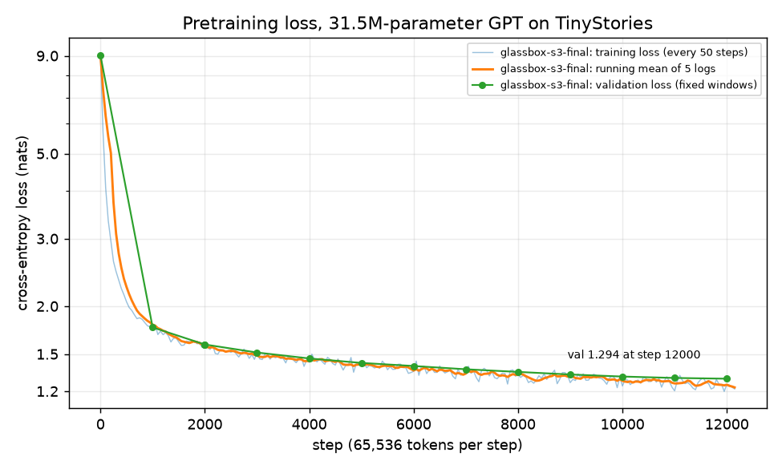

# MiniGPT-Stack + Glassbox: a small LLM built from scratch, then opened up with a sparse autoencoder

A 31.5M-parameter GPT trained from scratch on TinyStories (own BPE tokenizer, own training loop), then instruction-tuned
(SFT), preference-tuned (DPO), served by an inference stack and a small HTTP server, and finally examined with a **sparse
autoencoder (SAE)** on one layer's activations ("Glassbox"): can individual SAE features be read as concepts, and can they be used to
steer the model's stories? Heavy training ran on free Kaggle T4 GPUs; everything else ran on an i3 / 8 GB Windows laptop (CPU).

**Status: complete for the agreed scope.** All code, experiments and write-ups are in this repo (181 tests pass with the local data and checkpoints; see Setup for a fresh clone). Open items are listed at
the end. The results are mixed, and this README says where they are weak.

## Results at a glance

Every number is from this repo's docs; limits are stated next to it. Pass/fail rules for Phase 6 were written down **before** the runs
(`docs/phase6_preregistration.md`) and not changed afterwards. A failed rule is reported as a failure.

| Part | Result | Where |
|---|---|---|
| Pretraining | 31,465,984 parameters, 12,158 steps (about 0.8B tokens, about 1.7 passes over TinyStories), validation loss **1.294**, about 8.8 GPU hours on a T4 | `docs/decisions.md` |
| SFT | Complete stories that end with an end-of-text token (93% of samples); keyword coverage 0.89 of 3 | `docs/results_final.md` |
| DPO | Keyword coverage **+0.8 to +0.9 of 3**, but end-of-story rate falls 92-93% -> 76-78% (missed its 85% guardrail). **Not an overall win**; no human evaluation. Re-checked with the corrected sampler: same result | `docs/results_final.md`, `docs/results_corrected_sampler.md` |
| Inference | KV cache 2-8x faster than recomputing; int8 weights shrink the file 4x (+0.04% perplexity) but are slower on CPU; fp16 on a T4 passes its quality gate; T4 decode is launch-bound | `docs/benchmark_*.md`, `docs/quantization_results.md` |
| SAE reconstruction (layer 4, 4096 features, k=32) | FVU 0.1413 (limit 0.15, **thin margin**), L0 32 (by construction), dead features 0.0, CE recovered 0.983 (limit 0.85) | `docs/decisions.md`, `docs/phase6_preregistration.md` |
| SAE transfer to the SFT model (A5) | **Passed**: FVU 0.144 plain / 0.158 template (limit 0.25), CE recovered 0.982 / 0.982 (limit 0.80) | `docs/decisions.md`, `docs/phase6_a5_report.json` |
| Feature labels | Most of 60 random features are token or phrase patterns ("to" after "didn't want"), not concepts. A blind check scored 60/60, which is weak evidence (random controls; the same model writes and scores the labels) | `docs/decisions.md` |
| **Steering (pre-registered)** | **Effect not established: 2 of 5 concept features pass** (night sky, furniture). Clothing has the biggest effect but breaks the text's fluency at every tested strength | `docs/steering_features.md` |



*Pretraining loss (log scale): training loss every 50 steps and validation loss on fixed windows every 1,000 steps; validation 1.294 at step 12,000.
Regenerate with `pip install -r requirements-plots.txt` then `python analysis/plot_loss.py` (needs `checkpoints/**/metrics.jsonl`, which is not in git).*

## How the project is built (phases)

| Phase | What | Key facts |
|---|---|---|
| 1 Data and tokenizer | Byte-level BPE trained from scratch, `tok8192.json`; TinyStories streamed into resumable uint16 shards | vocab 8192 (bytes 0-255, `<|endoftext|>` 256, `<|pad|>` 257); official validation split; about 467M train tokens in 5 shards |
| 2 Model | Decoder-only GPT: RoPE, RMSNorm, SwiGLU (hidden 1536), tied embeddings, 8 blocks, d_model 512, context 512 | 31,465,984 parameters; record/inject hook at the output of any block (used by Phase 6) |
| 3 Pretraining | Resumable trainer (checkpoints, kill-and-resume drill, fp16 with GradScaler), run in three Kaggle sessions | LR 1e-3 (sweep 3e-4 / 6e-4 / 1e-3), warmup 500, 65,536 tokens per step, about 39.6k tokens/s |
| 4 SFT and DPO | Instruction prompts synthesized from stories ("Write a short story using all of these words: a, b, c"); graded-rule preference pairs; hand-written DPO loss | no instruction dataset was verified, so prompts are synthetic; DPO lr 5e-6, beta 0.1, 2 seeds |
| 5 Inference | Static KV cache, generation engine, int8 / fp16 variants, HTTP server (Starlette), benchmarks on CPU and T4 | see "Inference" below |
| 6 Glassbox | TopK SAE on the layer-4 residual of the base model; feature scans; labeling check; pre-registered steering experiment; local demo | see "Phase 6" below |

## Repo map

```
configs/      one yaml per experiment (30M base, 85M stub, debug CPU)
tokenizer/    BPE trainer and tokenizer         data/       shard preparation (resumable)
model/        GPT, attention, blocks (hooks)    train/      pretrain, SFT, DPO, pairs, evaluation, checkpoints
inference/    KV cache, generation engine (inject hook), quantization, server
bench/        speed, quantization check, win rate
interp/       SAE, activation extraction, SAE training and evaluation, feature scan
analysis/     Phase 6 experiments: A5 transfer, feature scan, labeling and blind check, steering, notebook generators and checkers
demo/         local steering demo (Starlette + one HTML page)
notebooks/    Kaggle notebooks (pretrain, SFT, DPO, bench, SAE probe and full run, steering)
tests/        181 tests (see Setup)  docs/       decisions log, results, pre-registration, benchmark write-ups
```
Licensed under MIT (`LICENSE`). Checkpoints (`*.pt`) are not in git. The SAE, base and SFT weights are pinned by SHA-256 in the scripts and docs.

## Setup and tests (Windows, Python 3.13)

```powershell
py -m venv .venv
.\.venv\Scripts\Activate.ps1
pip install -r requirements.txt
python -m data.prepare --out_dir data --max_docs 1000       # small debug shards (needs network, about 1 min); the tests need them
python -m pytest tests/ -q
```
- **On a fresh clone the suite needs `data.prepare` first.** Without the shards 28 tests fail with `FileNotFoundError: data\meta.json`;
  with them, 174 pass and 7 skip (6 skips need the real SFT checkpoint, which is not in git; 1 is the plot test, which needs matplotlib). With all local data and checkpoints present, all 181 pass.
- The tests were developed with torch 2.9 (CPU). A fresh install picks the newest torch (2.15): on a clean clone it passed the same suite, but with the
  real SFT checkpoint present one float-tolerance test (`test_static_cache_real_sft_model_matches_full_forward_and_tuple_cache`, max difference 1.47e-5
  against a 1e-5 limit) failed on 2.15. Use torch 2.9 to reproduce the full pass.
- `make install` / `make test` work too if `make` is installed (Git Bash / WSL).

### Smallest end-to-end path (CPU, a few minutes; every command below was run on a fresh clone)

```powershell
python -m tokenizer.train_tokenizer --corpus_mb 1 --vocab_size 512 --out tok512.json     # tokenizer demo (the real one is tokenizer/tok8192.json)
python -m train.pretrain --config configs/debug_cpu.yaml --resume none --max_steps 20 --ckpt_dir out/ckpt   # loss falls from 9.0
python -c "import torch; from common.config import load_config; from model.gpt import GPT; from tokenizer.bpe import BPETokenizer; from inference.generate import Generator; c=load_config('configs/debug_cpu.yaml'); m=GPT(c['model']); m.load_state_dict(torch.load('out/ckpt/weights_step20.pt', weights_only=True)); m.eval(); print(Generator(m, BPETokenizer.load(c['data']['tokenizer_path'])).generate('Once upon a time', n=1, max_new=24, stop_at_eot=False).texts)"
python -m interp.train_sae --config configs/debug_cpu.yaml --weights out/ckpt/weights_step20.pt --out_dir out/sae --layer 1 --n_features 128 --k 4 --batch_tokens 256 --buffer_tokens 1024 --epochs 3 --ctx 64 --norm_windows 8 --eval_windows 8 --warmup_steps 2
```
A 20-step model writes word salad and the debug-scale SAE is meaningless (FVU about 0.75); this path only shows the code runs end to end.
The real results need the full data, the Kaggle runs and the checkpoints described below.

### Checkpoints are not published

`*.pt` files are not in git and are not hosted anywhere public. The server, the demo and the Phase 6 scripts need them
(`checkpoints/glassbox-sft-final/sft_final_best.pt`, `checkpoints/glassbox-s3-final/weights_step12158.pt`,
`checkpoints/glassbox-sae-l4/sae_latest.pt`) and stop with a `FileNotFoundError` without them. They are pinned by SHA-256 in the scripts and docs, so a
regenerated copy can be checked. Everything that does not need them (tests, the debug path above, reading the result files in `docs/`) works from a clone.

## Run it

```powershell
python -m inference.server --weights checkpoints/glassbox-sft-final/sft_final_best.pt   # HTTP server, loopback only (docs/server.md)
python -m demo.app                                                                      # steering demo at http://127.0.0.1:8000
python -m train.eval_quality --help                                                     # DPO / SFT generation evaluation
python analysis/a5_transfer.py --help                       # SAE transfer to the SFT model (CPU, about 3 h for both models)
python analysis/scan_features.py --help                     # feature scan (CPU, about 1 h per 10M tokens)
python analysis/steering.py gen --help                      # steering cells (GPU advised: about 3.2 h on a T4)
python analysis/steering.py analyze --out_dir <dir>         # pre-registered steering verdict
```

## Phase 6: what the brain scanner found

- **The SAE is a good compressor of layer 4**: it explains about 86% of the variance, and keeping its reconstruction costs little
  next-token accuracy (CE recovered 0.983). It transfers to the SFT model almost unchanged (A5 passed).
- **Most of its features are about words and phrases, not ideas.** Of 4096 features, only 509 pass a mechanical "not a single token / not
  punctuation" check, and few of those are concepts. The ones that are (clothing, the night sky, furniture) are real.
- **Steering works for some concepts.** Adding a feature's direction raised the rate of concept words from about 1% to 20-90% for night sky and
  clothing, while a random direction of the same size and the opposite sign did nothing. But the text had to stay fluent (end-of-story rate,
  variety, perplexity), and that held at some strength for only 2 of the 5 pre-chosen features, so the pre-registered claim ("at least 3 of 5")
  is **not established**.

| Feature | Concept | Result | Why |
|---|---|---|---|
| 3651 | household furniture | passes at strength 4 | gain +0.15 over a random control, fluent |
| 1131 | night sky | passes at strength 2 | gain +0.21, fluent |
| 1672 | clothing | fails | gain +0.66 already at strength 1, but text variety drops 0.054 (limit 0.05) and breaks further up |
| 1319 | foods and animals | fails | gain +0.076 at strength 4 (needs 0.10), and fluency fails there |
| 3990 | an animal as subject | fails | no effect |

- **Steps in order:** SAE training and acceptance (A1-A4) -> transfer to the SFT model (A5) -> scan 10M train tokens and 4M validation tokens ->
  label 60 random features and check them blind -> pick 5 concept features by a fixed seeded rule (`docs/steering_features.md`) -> steering run
  on a T4 (4550 generation cells, 3.24 GPU hours) -> verdict.
- **Caveats that matter:** "concept rate" counts whole words, so strengths that produce word-salad can still score on that metric (the
  fluency rule is there to catch it); the labeler and the label-checker are the same model; the five features were chosen by a fixed seeded walk with
  my judgment on which labels name a concept; only the SFT model was steered.
- Full write-ups: `docs/steering_features.md` (features, tables, controls), `docs/decisions.md` (each phase, with provenance), raw verdicts in
  `docs/phase6_steering_verdict.json`.

## Demo (local, CPU)

```powershell
python -m demo.app          # http://127.0.0.1:8000
```
A page with a strength slider for the two steering features that passed (night sky, household furniture). It writes the same story twice with
the same seed, unsteered and steered, and marks the concept words. A note at the top says the other three features (clothing, foods and animals,
an animal as a subject) did not show a usable effect and are not offered, and that the overall claim is "not established". Beyond the tested
strength the page warns that text degrades. Tested through its API and on the real model; the page layout itself has not been checked in a browser.

## Documentation index

| File | Content |
|---|---|
| `docs/decisions.md` | Log of every phase: decisions, bugs found, what was measured (the most complete record) |
| `docs/phase6_preregistration.md` | The Phase 6 rules and thresholds, written before the runs, plus the measured layer-4 result |
| `docs/steering_features.md` | Feature-selection rules, the five chosen features, steering results and controls |
| `docs/results_final.md`, `docs/results_folded.md`, `docs/results_corrected_sampler.md` | DPO evaluation, apostrophe re-scoring, corrected-sampler re-evaluation |
| `docs/benchmark_*.md`, `docs/quantization_results.md`, `docs/server.md` | Inference benchmarks, int8 / fp16 check, server notes |
| `docs/phase6_*.json`, `docs/phase6_labeling/` | Raw A5 report, steering verdict, label sample and scores |

## Not done / open items

- **Spot-check ratings** (30 random SAE labels, `docs/phase6_labeling/spotcheck30.md`) and the **DPO human evaluation**
  (`docs/human_spotcheck.md`) are unrated; they are for a human to fill in.
- **The DPO preference pairs were built with the old sampler** (see Limitations). Rebuilding them and retraining DPO needs a GPU (roughly 1-2 hours,
  unmeasured); the generation metrics themselves were re-evaluated with the corrected sampler.
- **Not started:** the `max_new=384` re-run, the mojibake retraining decision, CUDA graphs / `torch.compile`, SAEs at layers 2 and 6, steering the base
  model, and finer steering strengths for clothing (not pre-registered).
- No 60-second video (dropped by choice).

## Limitations

- **Pair prompts overlap SFT training data.** The DPO pair prompts (train-stream
  story idx 200-1499) are the same prompts, with the same gold stories, that SFT
  trained on (SFT used idx 0 to about 20,000 for 2 epochs). DPO therefore starts
  from a policy that has already seen these prompts and their chosen stories. The
  evaluation prompts come from the validation split, which neither SFT nor the
  pairs touch, so this affects how much the DPO signal can teach, not the eval.
- **Eval keyword filter uses a hand-made stopword list.** `train/eval_quality.py`
  drops function words from the eval keyword pool using a hand-written list of
  4+ letter words. It was checked only on a 200-story sample of the local
  validation shard (about 24% of unfiltered keywords and 56% of prompts had at
  least one stopword there), so the list is not validated at scale. SFT and pair
  building still use the unfiltered `synth_prompt`.
- **About 6% of validation gold stories exceed 256 tokens.** On the local
  200-story validation sample, 94% of gold stories (plus EOT) fit in
  `max_new=256`. A model that writes a story that long cannot reach its EOT, so
  `bench/win_rate.py` counts it as invalid (score -1). The sample is small. In
  the final run `eot_rate` fell from 93.2% (SFT) to 78.7% / 81.3% (DPO seeds 0
  / 1); whether those extra unfinished stories are stories that run out of
  tokens or stories that fail to end is not determined, and a `max_new=384`
  re-run is pending.
- **The finished-only comparison is descriptive, not paired.** The coverage
  numbers restricted to finished stories in `docs/results_final.md` condition
  on finishing, which selects a different subset of samples for each model, so
  they do not compare the same stories.
- **DPO was trained on the same criterion it is scored on.** The pair rule is
  whole-word keyword coverage, and the headline metric is keyword coverage, so
  the coverage gain is circular evidence of story quality.
- **The `eot_rate` guardrail (85%) was missed.** After DPO (lr 5e-6),
  `eot_rate` was 78.7% (seed 0) and 81.3% (seed 1) against 93.2% for SFT.
- **Sampling seeds are fixed per prompt.** Every model draws the same
  randomness for a given validation prompt, so the bootstrap CIs (over prompts)
  do not include sampling variation.
- **Two training seeds only.** Variation across training seeds is based on two
  runs, which also use different held-out prompt splits.
- **No human evaluation yet.** The blind spot-check in `docs/human_spotcheck.md`
  has not been rated.
- **The training corpus is partly garbled (mojibake).** In the Hub's parquet
  version of TinyStories (what the default loader and `data/prepare.py` read),
  UTF-8 curly quotes and dashes were decoded as cp1252: a right single quote
  (U+2019) appears as U+00E2 U+20AC U+2122, and the closing double quote loses a
  byte. 5.4% of stories in the local 1,000-story smoke shard contain the garbled
  apostrophe and none contain a correct one; streaming 3,000 stories per split
  from the Hub gives about 4-5% of stories (4.9% train, 3.7% validation, so
  approximate). The original raw `.txt`
  files are clean, so the defect is in the parquet files, not in `prepare.py`
  (`docs/source_mojibake_check.md`). The model reproduces it: 1.7% (SFT) and
  3.3% / 2.3% (DPO seeds 0 / 1) of samples contain the garbled apostrophe. The
  whole-word scorer can undercount a keyword next to these characters (U+00E2 is
  a word character), but re-scoring with the apostrophe folded back changed 0
  of 1,800 samples (1 when every garbled sequence is folded), so the reported
  coverage is unaffected here (`docs/results_folded.md`).
- **The old sampler re-feeds the last prompt token.** `train/sample.py::sample_completions`
  caches the last prompt token twice, which shifts the first next-token
  distribution slightly (total variation 0.047 on the SFT template prompt). It
  affects every generation made with it: the preference pairs, `eval_quality`
  and `win_rate` generation metrics, the final-run results and the spot-check
  samples. It does not affect DPO training or held-out losses, SFT/pretraining,
  or perplexity. SFT and DPO were sampled the same way, so their comparison is
  consistent. **Re-evaluated on 2026-11-10** with the corrected sampler
  (`docs/results_corrected_sampler.md`): coverage gain +0.79 / +0.90, `eot_rate`
  change -15.8 / -13.8 points, same conclusions. Not redone: the preference
  pairs DPO trained on were still built with the old sampler (needs a GPU).

## DPO learning rate

The DPO final runs use `lr = 5e-6`. It was chosen for **stability**, not as a proven win over the other arms: in the 3-arm sweep (1e-6, 5e-6, 2e-5; 444 updates, beta 0.1) the 2e-5 arm overfit the training pairs and early-stopped at update 351 (held-out loss rose after step 200), and the 1e-6 arm was still improving at its last eval. Held-out reward accuracy (198 pairs, standard error about 0.035) could not separate the arms, and 5e-6 vs 2e-5 differed by only about 0.012 in best held-out loss, so the choice is a mild preference. It was fixed before the final evaluation and not tuned afterwards.

## DPO result

DPO raises keyword coverage (+0.8 of 3, 95% CIs exclude zero, both training
seeds agree) and lowers `eot_rate` by 12-15 points (published numbers, old
sampler), below the 85% guardrail. Re-evaluated with the corrected sampler
(`docs/results_corrected_sampler.md`): coverage +0.79 / +0.90 and `eot_rate`
-15.8 / -13.8 points, ending at 76% / 78%. It is not an overall win. Details,
finished-only coverage and length distributions: `docs/results_final.md`.

## Inference (Phase 5): what was measured

Code: `inference/kv_cache.py` (static preallocated KV cache), `inference/generate.py`
(generation engine), `inference/quantize.py` (int8 weight-only, fp16),
`inference/server.py` (HTTP server: `/health`, `/generate`, `/generate/stream`;
loopback-only by default, per-request timeout, bounded queue, no prompt logging;
see `docs/server.md`). Protocol:
`docs/benchmark_protocol.md`. Results come from two machines and should be read
separately: a laptop CPU and a Kaggle Tesla T4. All results are for this 31.5M
parameter model, the SFT checkpoint, and **K=4 prompts per regime**.

Server notes (`docs/server.md`):

- **Built on Starlette directly, not FastAPI.** The development machine had FastAPI
  0.115.6 installed next to Starlette 1.8.0, a pair that cannot construct an app. The
  server needs only Starlette and pydantic, so `fastapi` was dropped from
  `requirements.txt` and `starlette`, `pydantic` and `uvicorn` are pinned to the
  versions the tests ran against.
- **A timed-out request discards its partial output** (`/generate` returns just a 504).
- **Requests are serialized** (one generation at a time, a bounded queue) and there is
  **no authentication**: it binds to 127.0.0.1 by default and should stay there.

### Laptop CPU (fp32, 6 threads, G=64) - `docs/benchmark_cpu.md`, `docs/benchmark_cpu_notes.md`

- **A KV cache is much faster than recomputing**: 2.2-7.9x end-to-end in the cells
  that were run.
- **Static vs tuple (`torch.cat`) cache is a clear win only for long prompts and
  n=32** (1.25-1.44x end-to-end). For short prompts at n=1 and n=8 there is **no
  measurable difference** (the confidence intervals include 1; the n=1 cells are
  noisier than the effect).
- **Time to first token** is not improved by the static cache and is slightly worse
  in a few cells. A likely cause is zero-filling the whole preallocated buffer
  inside the timed window, but **that explanation is untested**.
- **int8 weight-only's value is file size, not speed**: the file is 0.25x of fp32
  (31.7 MB vs 125.9 MB) at +0.04% gold-story perplexity
  (`docs/quantization_results.md`). It was 1.17-1.65x *slower* than fp32 on the CPU
  (no fused int8 kernel).

### Tesla T4 (fp32 and fp16, G=128, 10 repeats) - `docs/benchmark_t4.md`

- **Decode is launch-bound.** The decode step is a flat ~10-11 ms for n=1, 8 and 32
  and for every cache type. That flat step is what suggests per-step launch and
  Python overhead rather than GPU compute; it was **diagnosed from the timings,
  not profiled**.
- **Cache gain depends on the cell.** A cache is 1.9x faster than no cache at n=8
  short prompts (1.91x, CI 1.86-1.95) and 1.13x at n=1 long, but there is **no
  measurable difference at n=1 short** (0.99x for tuple, CI 0.99-1.01).
- **Static vs tuple matters only at n=32 with long prompts** (1.14x end-to-end, CI
  1.13-1.16); everywhere else there is no measurable difference (about 1% at most).
- **fp16 helps time to first token but not decode.** First token is faster where the
  prefill is large (n=8 long 2.72x, n=32 long 4.75x, n=32 short 1.38x) and slightly
  slower at n=1 short (0.95x); the per-step decode is 4-6% *slower* in most cells.
  fp16 halves the KV cache and model memory, and passed its pre-registered quality
  gate (gold-story perplexity 2.6360 vs 2.6361, -0.003%; rule: within 2%).
- **Batching is nearly free.** Static fp32 on short prompts: about 97, 772 and 3,013
  tokens/s at n=1, 8 and 32, with the step time essentially unchanged (10.3-10.6 ms).
- **Scope.** These numbers are specific to this model and this GPU (a T4 with 2 torch
  threads on Kaggle); they say nothing about larger models or GPUs where decode is
  compute-bound. CUDA graphs / `torch.compile` were not tried (see
  `docs/decisions.md`).
